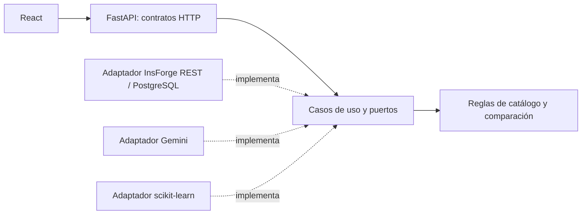

# ORIENTA

Explora y compara opciones académicas de Lima Norte. MVP 1 con inicio, catálogo,
búsqueda y filtros combinables, detalle, comparación de dos ofertas y explicación
con Gemini según prioridades declaradas. No requiere cuenta ni incluye un test
vocacional completo.

## Estado y datos

Implementado y ejecutándose localmente: React + TypeScript, FastAPI + Python y
PostgreSQL administrado en InsForge. El libro entregado contiene 414 ofertas,
170 carreras, 23 instituciones y 27 sedes. La aplicación consulta PostgreSQL;
el Excel es una entrada de importación, no la base de datos del sitio.

Gemini Flash-Lite fue probado con una respuesta real, fuentes válidas y empate
permitido. La comparación básica funciona cuando Gemini falla. El índice ML
mide coincidencia léxica y el clasificador propone áreas editoriales; ninguno
predice éxito ni compatibilidad vocacional.

## Arquitectura y estructura



Frontend por páginas, funcionalidades y recursos compartidos. Backend separa
dominio, aplicación, persistencia, ML, IA e interfaces HTTP; la fábrica compone
dependencias y clientes una vez por proceso.

```text
frontend/src/{app,pages,features,shared}/
frontend/public/images/          WebP e identidad oficial
backend/app/{domain,application,infrastructure,interfaces}/
backend/ml_artifacts/            modelos y manifiestos revisados
backend/tests/                   pruebas unitarias, HTTP e integración opt-in
migrations/                      SQL versionado para InsForge CLI
ml/notebooks/                    notebook original de Colab
scripts/                         auditoría y ejecución local
docs/                            decisiones, datos y evidencias
.github/                         CI y plantilla de PR
```

## Requisitos e instalación

Node 22.12+ y Python 3.13; uv 0.11.0 para resolver el entorno y Docker para
verificar la imagen. En esta PC los entornos ya están instalados.

```powershell
Copy-Item .env.example .env
Copy-Item frontend/.env.example frontend/.env
cd backend
uv sync --frozen
```

En otra terminal:

```powershell
cd frontend
npm ci
npx playwright install chromium
```

No sobrescribas un .env que ya contenga tus credenciales. Completa las variables
en archivos locales o en el gestor de secretos del servicio de despliegue.

## Variables

| Variable | Uso |
|---|---|
| APP_ENV | development o production |
| CORS_ORIGINS | Array JSON con orígenes concretos permitidos |
| INSFORGE_BASE_URL | URL real de la instancia PostgreSQL/REST |
| INSFORGE_API_KEY | Clave administrativa, exclusivamente en backend |
| GEMINI_API_KEY | Clave de Google, exclusivamente en backend |
| GEMINI_MODEL | Predeterminado probado: gemini-3.5-flash-lite |
| ML_ARTIFACTS_PATH | ml_artifacts desde backend |
| VITE_API_BASE_URL | Única variable pública del frontend: URL de FastAPI |

DATABASE_URL no se usa con este adaptador; no se deduce desde la API key.
Los secretos y la configuración local de InsForge están ignorados por Git.

## Migraciones e importación

Con InsForge CLI vinculado a la instancia, desde la raíz:

```powershell
npx -y @insforge/cli db migrations up --all
```

Desde backend, validar primero y aplicar después:

```powershell
uv run python -m app.infrastructure.persistence.import_excel RUTA_AL_EXCEL
uv run python -m app.infrastructure.persistence.import_excel RUTA_AL_EXCEL --apply
```

Cada lote se ejecuta en una transacción, con upsert por ID, validación de claves
y rollback ante error. No hay borrados masivos. Tarifas e históricos permanecen
separados de ofertas actuales. No se usa SQLAlchemy, por lo que las migraciones
son SQL de InsForge CLI y no Alembic. Detalles en [datos](docs/datos.md).

## Ejecutar localmente

Desde la raíz en Windows, después de instalar dependencias y configurar .env:

```powershell
.\scripts\start-local.ps1
```

Abre http://127.0.0.1:5173 y mantiene los procesos ocultos en segundo plano.
La opción -NoBrowser solo inicia/verifica servicios. Conserva procesos que ya
usen los puertos y confirma que respondan ORIENTA y su API. Logs locales en
frontend/local-frontend*.log y backend/local-backend*.log, ignorados por Git.

Alternativa con terminales visibles:

```powershell
cd backend
uv run uvicorn app.main:app --host 127.0.0.1 --port 8000 --reload
```

```powershell
cd frontend
npm run dev
```

Frontend: http://127.0.0.1:5173. OpenAPI: http://127.0.0.1:8000/docs.
/health comprueba el proceso; /ready comprueba PostgreSQL y reporta ML y
configuración IA sin realizar llamadas de pago.

## Modelos y explicación

El notebook de ml/notebooks/ prepara y evalúa etiquetas editoriales por grupos,
entrena el clasificador y exporta un índice TF-IDF. Se reutiliza la exportación
real del usuario sin reentrenarla. El backend verifica hashes y versiones antes
de cargar objetos joblib de procedencia controlada, una vez por proceso.

La explicación Gemini cita fuentes del contexto, distingue datos editoriales,
permite ausencia de ganador y conserva la comparación ante errores. Las
preferencias se envían a Google cuando se solicita el análisis y no se guardan
en PostgreSQL. Ver [ML](ml/README.md), [auditoría](docs/auditoria-ml.md) e [IA](docs/ia.md).

## Pruebas y CI

```powershell
cd backend
uv run ruff check . ../scripts
uv run mypy app
uv run pytest
uv run python -m unittest discover -s ../scripts -p "test_*.py"
```

```powershell
cd frontend
npm run lint
npm run typecheck
npm run build
npm run test:e2e
```

Las pruebas UI usan fixtures públicas y dobles explícitos de IA, ajenos al
runtime. La integración real de importación es opt-in con ORIENTA_EXCEL apuntando
al libro entregado. CI ejecuta lint, tipos, pruebas, build frontend, navegador
y construcción Docker. [Resultados y límites](docs/verificacion.md).

## Despliegue y contribución

Frontend preparado para Vercel (raíz frontend, salida dist, rutas SPA). Backend
preparado para Render con Docker, usuario sin privilegios y puerto PORT.
La interfaz responde en [Vercel](https://orienta-proyecto.vercel.app/), pero la
ruta de ofertas probada devuelve el HTML de la SPA, no una respuesta JSON de
FastAPI. El backend público no está verificado; el issue
[#50](https://github.com/HuamaniAlexander/Orienta-Proyecto/issues/50) registra
un fallo de configuración de Render que requiere corregirse y redesplegarse.
El release v0.1.0 se promovió a `main` mediante el [PR #23](https://github.com/HuamaniAlexander/Orienta-Proyecto/pull/23).
[Pasos y estado de despliegue](docs/despliegue.md).

Ramas por funcionalidad desde dev, commits Conventional Commits y PR hacia dev.
Las integraciones en dev fueron autorizadas por el usuario después de comprobar
CI; se conservan los commits mediante merge. [Plan y PR](docs/plan-mvp1.md).
Proyecto actual: [repositorio](https://github.com/HuamaniAlexander/Orienta-Proyecto)
y [tablero oficial Orienta - PROYECTO](https://trello.com/b/rGV9WAdT/orienta-proyecto);
sus tarjetas y checklists prevalecen sobre el CSV histórico.

## Fuentes y límites

Excel, notebook, logo y prototipos entregados por el usuario. La información
académica conserva las fechas y fuentes del libro; no se afirma haber auditado
de nuevo todas sus páginas. No se inventan montos, mallas, salarios, horarios o
empleabilidad. Las duraciones conservan su unidad; los costos no se comparan
como mensualidades cuando sus conceptos y condiciones son distintos.

Las imágenes generadas son ilustrativas. El logo oficial se conserva y los
iconos institucionales provienen de sus sitios. Recursos WebP servidos con el
frontend; InsForge se reserva para PostgreSQL. [Procedencia visual](docs/recursos-visuales.md).

Como referencia del MVP 1 previo: [repositorio](https://github.com/MartinRojas0/orienta-compara-mvp1)
y [Trello](https://trello.com/b/zENIbtAv/%F0%9F%8E%93-orienta-compara-mvp-1).
Su README describe SQLite y los PR [#1](https://github.com/MartinRojas0/orienta-compara-mvp1/pull/1)
y [#2](https://github.com/MartinRojas0/orienta-compara-mvp1/pull/2) documentan
entregas de catálogo y comparación. En este repositorio, los
[PR #7](https://github.com/HuamaniAlexander/Orienta-Proyecto/pull/7),
[#8](https://github.com/HuamaniAlexander/Orienta-Proyecto/pull/8),
[#9](https://github.com/HuamaniAlexander/Orienta-Proyecto/pull/9) y
[#10](https://github.com/HuamaniAlexander/Orienta-Proyecto/pull/10) registran
comparación, ML, IA y QA; los [PR #23](https://github.com/HuamaniAlexander/Orienta-Proyecto/pull/23)
y [#24](https://github.com/HuamaniAlexander/Orienta-Proyecto/pull/24), el release
v0.1.0 y la sincronización de `dev`. No se encontró audio, transcripción ni otra
fuente verificable de observaciones del profesor en los materiales consultados;
no se atribuyen recomendaciones sin esa evidencia.
