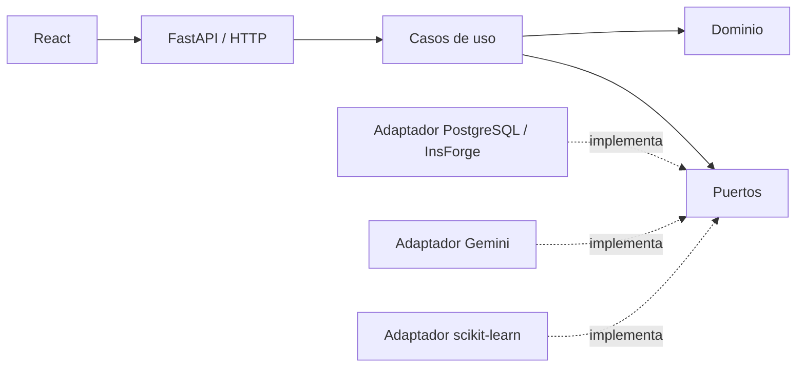

# Arquitectura

El dominio no importa FastAPI, SQL, SDKs ni proveedores. Bootstrap compone
puertos y adaptadores. Los routers solo validan y traducen solicitudes.
No se crean capas vacías: las funcionalidades añadirán sus entidades y puertos.

Estado actual: fábrica FastAPI y endpoint de vivacidad, configuración de CORS y
frontend de verificación del entorno. Aún no existen adaptadores de negocio.
`/health` confirma el proceso, no disponibilidad PostgreSQL/ML/Gemini.
La disponibilidad real se incorporará al integrar persistencia.
