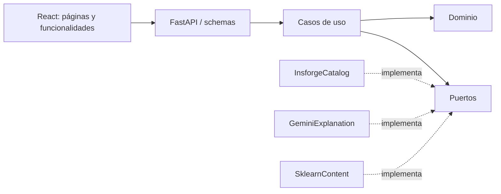

# Arquitectura hexagonal

El dominio no importa FastAPI, HTTP, InsForge, Gemini ni scikit-learn.
AcademicOffer distingue carrera_id, institucion_id, sede_id y oferta_id.
compare_offers rechaza duplicados y compara criterios sin convertir unidades
ni imputar costos. Los DTO de salida preservan valores ausentes.

Los casos de uso Catalog, Compare y Explain dependen de CatalogRepository,
ContentAnalyzer y ExplanationProvider. Los adaptadores implementan esos puertos:
InsforgeCatalog consulta tablas/vista PostgreSQL mediante REST; SklearnContent
valida y carga artefactos; GeminiExplanation gestiona el contrato generativo.

Los routers validan solicitudes y traducen resultados. create_app compone
clientes HTTP, configuración, repositorio, índice ML y proveedor IA mediante
el ciclo de vida de FastAPI. Los clientes se cierran al apagar el proceso.

## Decisiones

- Persistencia REST desde backend: existe una API key real, no una cadena
  PostgreSQL directa. No se inventa DATABASE_URL. SQL se versiona y aplica por CLI.
- Migraciones en migrations/ de la raíz: convención real de InsForge CLI.
- Todas las tablas y el importador están restringidos al administrador; el
  estudiante accede exclusivamente a contratos públicos de FastAPI.
- Catálogo normalizado y una vista de lectura con campos explícitos, paginación
  estable y filtros sobre IDs nominales. Referencias pequeñas se cachean cinco minutos.
- Entidades históricas y tarifas separadas; ninguna duración desconocida se vuelve cero.
- Modelos revisados dentro del paquete backend y con bytes preservados por Git.
- Selección de hasta dos ofertas en memoria y sessionStorage; la comparación
  vuelve a consultar los registros actuales. Los filtros viven en la URL.
- Gemini es auxiliar. Su indisponibilidad no bloquea el catálogo ni el comparador.
  Caché y coalescencia por proceso, con límites explícitos en docs/ia.md.
- La web no tiene autenticación de estudiantes, pagos ni un test vocacional.
